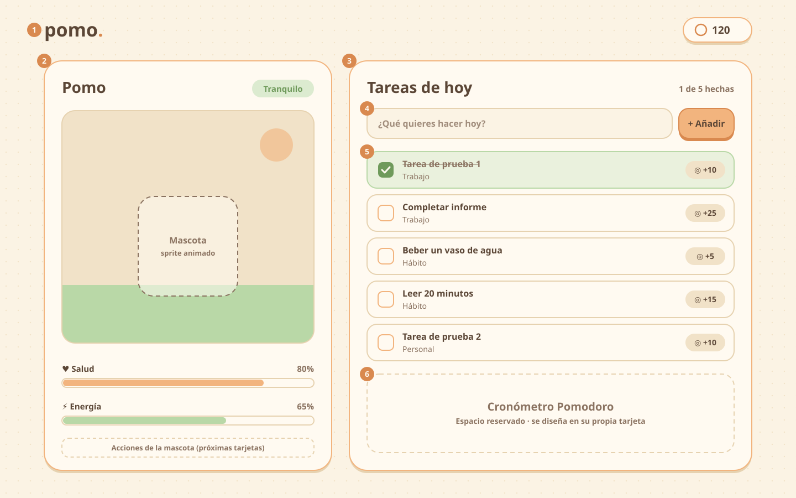

# Wireframes de Pomo

**Tarjeta del Kanban:** Mockup y UI/UX — diseñar los wireframes en Figma con la paleta cálida estilo lofi.
**Criterio de aceptación:** pantalla principal y lista de tareas diseñadas y **aprobadas por el equipo**.

| Archivo | Qué muestra |
|---|---|
| [01-pantalla-principal-escritorio.svg](01-pantalla-principal-escritorio.svg) | Pantalla principal en escritorio (1440 × 900): mascota a la izquierda, tareas a la derecha. |
| [02-lista-de-tareas-movil.svg](02-lista-de-tareas-movil.svg) | La misma pantalla en móvil (390 px): paneles apilados, lista de tareas completa. |
| [03-estados-lista-de-tareas.svg](03-estados-lista-de-tareas.svg) | Estados de cada tarea y del campo «Nueva tarea», incluida la lista vacía. |

## Cómo llevarlos a Figma

1. Crea un archivo de Figma llamado **Pomo · Wireframes**.
2. Arrastra los tres `.svg` al lienzo (o *Archivo → Importar*). Figma los convierte en capas editables; cada bloque llega como un grupo con nombre (`Cabecera`, `Panel mascota`, `Lista de tareas`…).
3. Selecciona cada importación y conviértela en *frame* (`Ctrl + Alt + G`, o clic derecho → *Frame selection*).
4. Comprueba que las fuentes **Fredoka** y **Nunito** están disponibles (vienen de Google Fonts, Figma las incluye).
5. Crea los estilos de color a partir de la paleta de abajo para reutilizarlos.

## Anotaciones (marcadores naranjas numerados)

1. **Cabecera.** Logotipo «pomo.» y contador de monedas siempre visible.
2. **Panel de la mascota.** Nombre, estado de ánimo, escena (sol de tarde y césped) y barras de salud y energía. El recuadro discontinuo es el hueco del sprite; de momento se usa un emoji 🐶. Debajo queda espacio para acciones futuras (alimentar, jugar…).
3. **Panel de tareas.** Título y progreso del día («1 de 5 hechas»).
4. **Nueva tarea.** Campo de texto y botón «Añadir». En móvil el botón se reduce a «+».
5. **Lista de tareas.** Cada fila: casilla, título, categoría y recompensa en monedas. Estados en el archivo 03.
6. **Cronómetro Pomodoro.** Espacio reservado; se diseñará en su propia tarjeta.

## Paleta (estilo lofi cálido)

Coincide con el bloque `@theme` de `src/index.css`.

| Nombre | Hex | Uso |
|---|---|---|
| `crema` | `#fbf3e4` | Fondo de la página |
| `crema-claro` | `#fffaf1` | Fondo de los paneles y tarjetas |
| `beige` | `#f1e2c8` | Escena, píldoras de monedas |
| `arena` | `#e6d2b0` | Bordes neutros y sombra sólida |
| `verde-pastel` | `#b9d8a7` | Césped, barra de energía, borde de completada |
| `verde-suave` | `#dcebd0` | Fondo de tarea completada, etiqueta de ánimo |
| `verde-hoja` | `#6f9a5b` | Casilla marcada, texto de ánimo |
| `naranja-suave` | `#f2b47e` | Bordes de panel, botón principal, barra de salud |
| `naranja-tostado` | `#d9894f` | Sombra del botón, punto del logo, monedas |
| `cafe` | `#5b4636` | Texto principal |
| `cafe-suave` | `#8a7260` | Texto secundario |

**Tipografía:** Fredoka (títulos, 600–700) y Nunito (texto, 400–800).
**Forma:** paneles con radio 32 px, tarjetas 18 px, píldoras redondas; sombra sólida de 5 px hacia abajo en lugar de sombras difusas.

## Aprobación del equipo

El criterio de aceptación exige la aprobación del equipo. Marca cada punto en la revisión:

- [ ] Pantalla principal (escritorio) aprobada
- [ ] Pantalla principal y lista de tareas (móvil) aprobadas
- [ ] Estados de la lista de tareas aprobados
- [ ] Paleta y tipografía aprobadas
- [ ] Wireframes importados en Figma y enlace añadido aquí: _pendiente_

Revisado por: _______ · Fecha: _______
